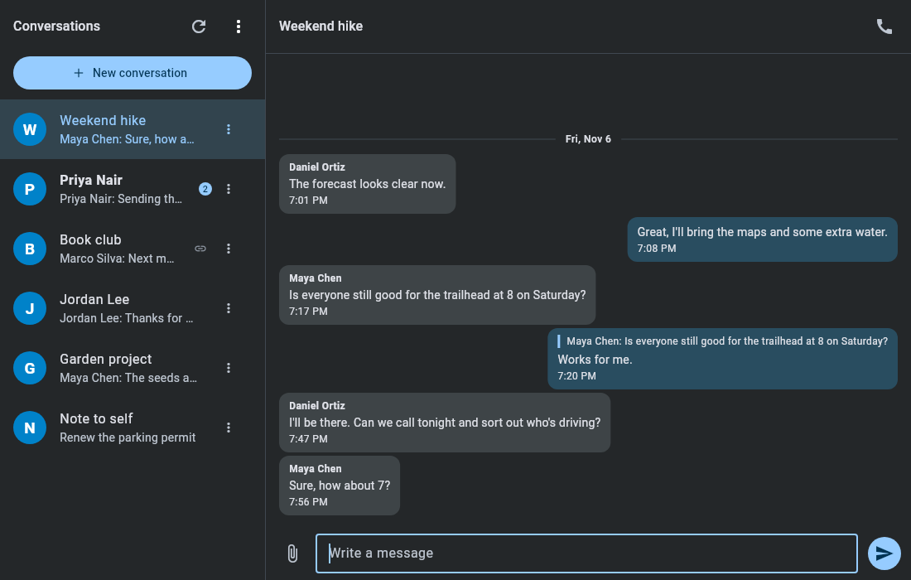
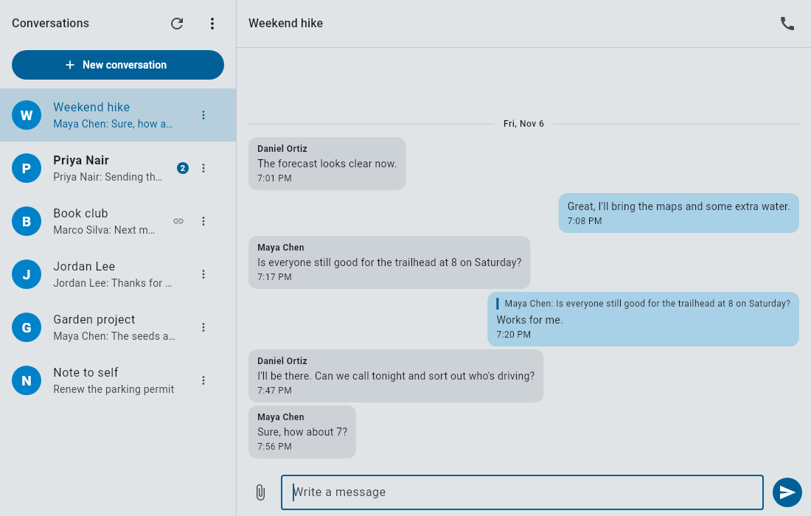
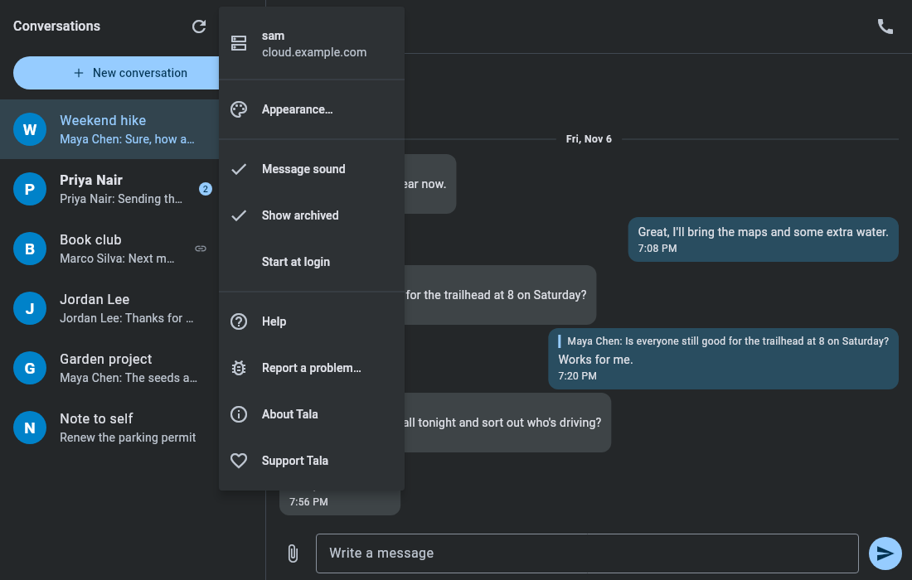
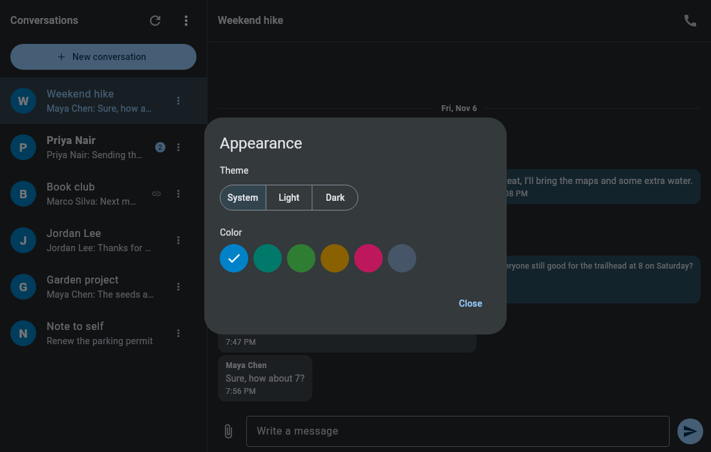
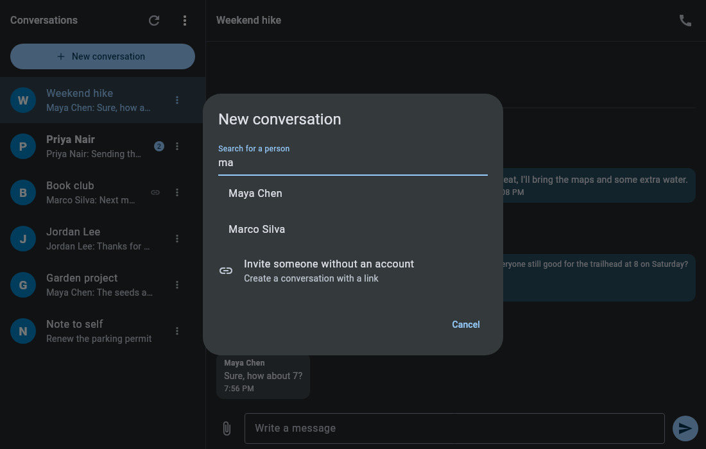
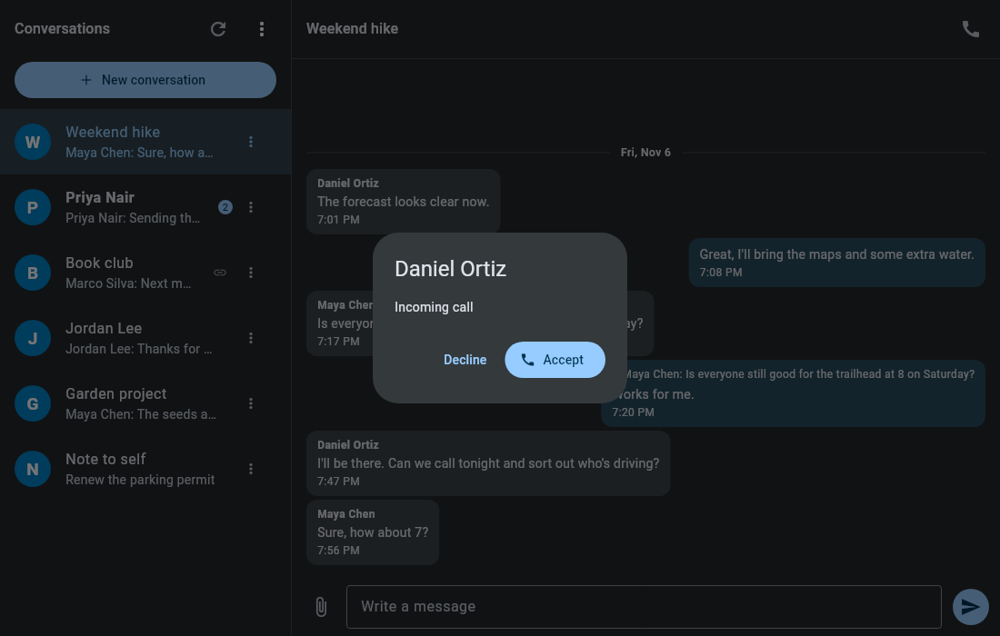
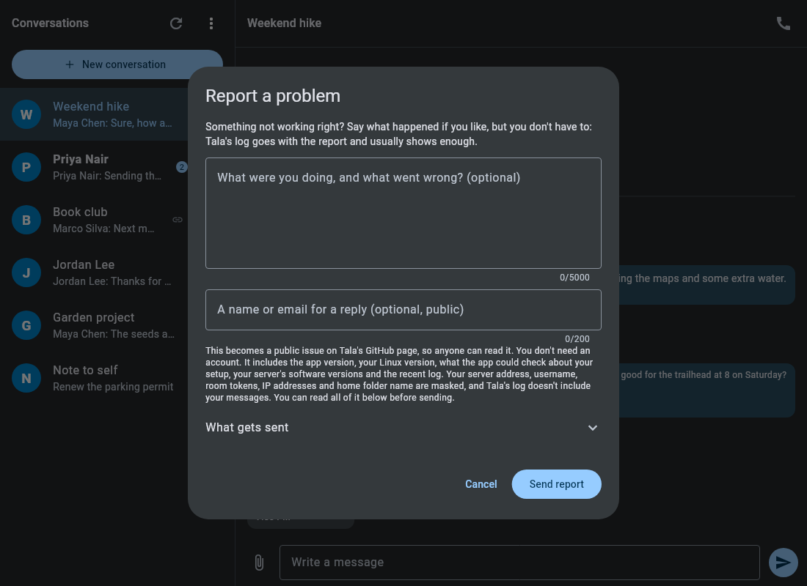
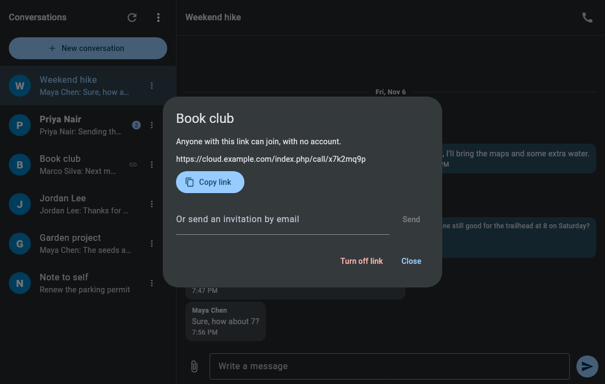

# Tala

[](https://snapcraft.io/tala)

[](https://snapcraft.io/tala)
[](https://github.com/kz6fittycent/tala/actions/workflows/snap-builds.yml)
[](LICENSE)

Chat, audio calls and video calls for Nextcloud Talk, as a native desktop app
for Linux. Tala (Old Norse "to speak") is an independent project, not affiliated
with or endorsed by Nextcloud GmbH.

Tala is free: no price, no ads. You sign in through your own server's login
page, and Tala keeps its app password in your desktop keyring. It's at an early
stage and in testing.



The people and conversations in these pictures are made up.

## Features

- Chat with replies, reactions, editing, deleting, file uploads and image previews
- Audio and video calls, with ringing for incoming calls
- Invite people with no account using a link or an email invitation (guests join
  in their browser)
- Desktop notifications with a chime, and an unread count on the dock icon
- Runs in the tray and can start at login
- Archive conversations, and optionally hide the archive
- Conversations and invitations from other Nextcloud servers (federation, not
  yet tested against a real one)
- Light, dark and system themes with six accent colors

Calls currently need a server with Talk's
[High Performance Backend](https://nextcloud-talk.readthedocs.io/en/latest/quick-install/).
Chat works without it.

## Install

Tala is a snap for 64-bit Linux (amd64), on the candidate channel while it's in
testing:

```
sudo snap install tala --candidate
```

Then connect the permissions it needs, once:

```
sudo snap connect tala:password-manager-service
sudo snap connect tala:camera
sudo snap connect tala:audio-record
```

Tala needs the first to save your sign-in, the second for video and the third
for your microphone.

## Screenshots

| | |
|---|---|
|  |  |
| Light theme | The menu |
|  |  |
| Theme and accent color | Starting a conversation |
|  |  |
| An incoming call | Reporting a problem |
|  | |
| Inviting someone without an account | |

More in the [wiki](https://github.com/kz6fittycent/tala/wiki).

## Help and reports

- [Wiki](https://github.com/kz6fittycent/tala/wiki): how to use Tala and fix common problems
- **Report a problem…** in the app's menu sends a report with its recent log, with
  no GitHub account needed. Reports become public issues, with your server,
  username and other private details masked, and you can read everything before
  it goes.
- [Issues](https://github.com/kz6fittycent/tala/issues)

## Building from source

You need [Flutter](https://docs.flutter.dev/get-started), plus
`libayatana-appindicator3-dev` and `libsecret-1-dev`.

```
flutter build linux --release --no-tree-shake-icons
```

The flag matters: without it, the release build's trimmed icon font can lose an
icon.

The screenshots come from `tool/make_screenshots.dart`, which draws the real
screens with invented data.

## Support Tala

Tala is free and stays free. A one-time or monthly tip on
[Ko-fi](https://ko-fi.com/kz6fittycent) helps keep it going.

## License

GNU Affero General Public License, version 3. See `LICENSE`.
